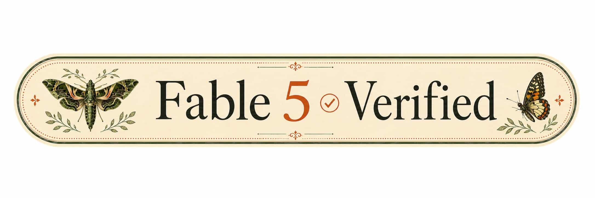

# ApplePackage

A Swift package and command-line tool for managing Apple apps, including searching, downloading, and authenticating with Apple services.

For a version with a graphical user interface (GUI) and an on-device installer, check out [Asspp](https://github.com/Lakr233/Asspp).

## Features

- **Authentication**: Login and logout from Apple accounts
- **Search**: Search for apps in the App Store
- **Download**: Download apps using your Apple account
- **Versions**: Retrieve version information for apps

## Installation

### Prerequisites

- Swift 6.2 or later
- macOS 15+
- Library deployment targets: iOS 18+, Mac Catalyst 18+, tvOS 18+, visionOS 2+

### Using Swift Run

Clone the repository and run the tool directly:

```bash
git clone https://github.com/Lakr233/ApplePackage.git
cd ApplePackage
swift run ApplePackageTool <subcommand>
```

For example:

```bash
swift run ApplePackageTool --help
```

## Usage

### Login

Authenticate with your Apple account:

```bash
applepackage login <email> <password> [--code <2fa-code>]
```

- `<email>`: Your Apple ID email address
- `<password>`: Your Apple ID password
- `--code`: Optional 2FA verification code

To sign the actual login request with SAP, supply your original complete
post-handshake context explicitly:

```bash
swift run ApplePackageTool login <email> <password> \
  --sap-context /absolute/path/to/post-handshake.json
```

The tool does not generate a fresh SAP handshake or select a recorded context
for you. In a terminal it can prompt for a verification code while retaining
the same signer; noninteractive callers should supply `--code`. See
[SAP integration](SAPIntegration.md) for the virtual IV address option, state
lifetime, library injection, and the offline tests. A matching offline
signature does not by itself establish that Apple accepts a live session.

### Logout

Remove stored credentials for an account:

```bash
applepackage logout <email>
```

- `<email>`: The email address of the account to logout

### Search

Search for apps in the App Store:

```bash
applepackage search <term> [--country <country-code>] [--limit <number>]
```

- `<term>`: Search term
- `--country`: Country code (default: US)
- `--limit`: Maximum number of results (default: 10)

### Versions

List available versions for an app:

```bash
applepackage versions <email> <bundle-id>
```

- `<email>`: Your Apple ID email address
- `<bundle-id>`: The bundle identifier of the app

### Download

Download an app:

```bash
applepackage download <email> <bundle-id> [--version-id <version>] --output <path>
```

- `<email>`: Your Apple ID email address
- `<bundle-id>`: The bundle identifier of the app
- `--version-id`: Optional specific version ID to download
- `--output`: Output path for the downloaded file

## Library Usage

Add ApplePackage as a dependency in your Swift package:

```swift
dependencies: [
    .package(url: "https://github.com/Lakr233/ApplePackage.git", from: "1.0.0")
]
```

Import and use:

```swift
import ApplePackage

// Example: Search for apps
let results = try await Searcher.search(term: "example", countryCode: "US", limit: 10)
```

## Dependencies

- [ZIPFoundation](https://github.com/weichsel/ZIPFoundation.git)
- [AsyncHTTPClient](https://github.com/swift-server/async-http-client.git)
- [Swift Collections](https://github.com/apple/swift-collections.git)
- [Swift Argument Parser](https://github.com/apple/swift-argument-parser)
- [OpenSSL for Swift Package Manager](https://github.com/Lakr233/openssl-spm) via AppleSAPKit

## Acknowledgments

- [ipatool](https://github.com/majd/ipatool) - Original inspiration and reference implementation
- [at-wr](https://github.com/at-wr) - Testing and quality assurance
- [Claude Code](https://claude.ai/code) by Anthropic - AI-assisted development

## Contributing

Contributions are welcome! Please feel free to submit a Pull Request.

## License

This project is licensed under the MIT License - see the [LICENSE](LICENSE) file for details.

## Disclaimer

This tool is for educational and personal use only. Please respect Apple's terms of service and copyright laws when using this software. We are not responsible if your Apple account gets banned or any other issues arise from using this tool.


